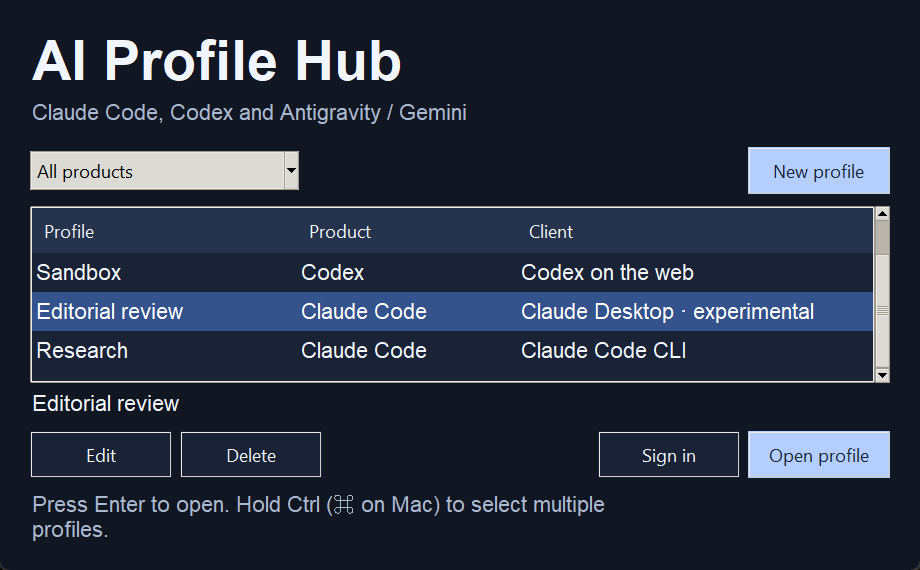
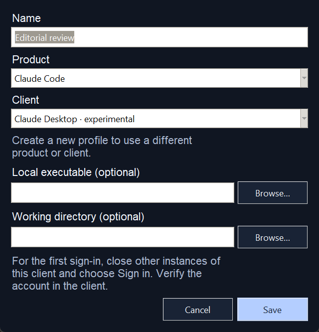
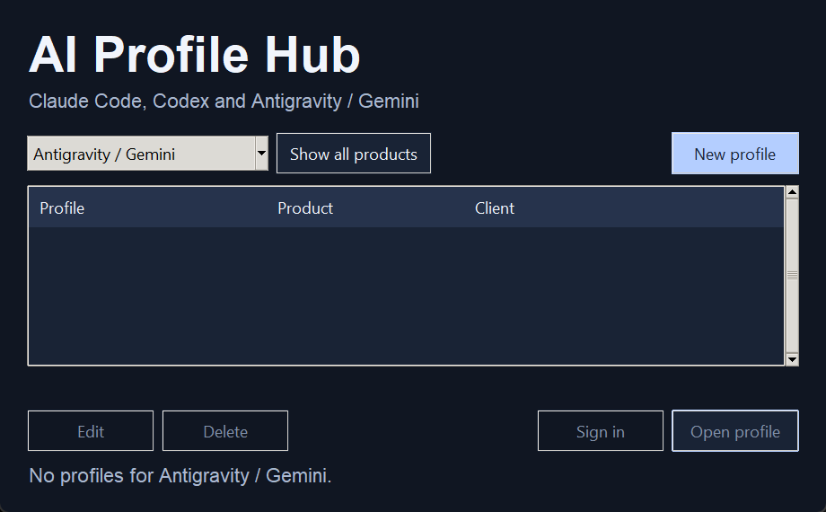

# AI Profile Hub

Desktop launcher for **Windows, macOS and Linux**. Manage profiles for different Claude Code, Codex and Antigravity / Gemini accounts. From one window you can open a website in a dedicated browser session, launch an installed client in a terminal or open a desktop app on your computer.



## Quick start

Open a terminal in the repository root after downloading or cloning the source.

You need Python 3.11 or later with Tkinter. On Windows and macOS, you can use the [python.org installer](https://www.python.org/downloads/). On Debian and Ubuntu, install `python3-tk` for the graphical interface. To open CLI profiles on Linux, you also need a graphical terminal such as GNOME Terminal, Konsole or xterm. On macOS, the first Terminal launch may require Automation permission.

On Windows, double-click `run.cmd` or run it from PowerShell.

```powershell
.\run.cmd
```

On macOS and Linux, run the shell launcher.

```sh
./run.sh
```

## Create and open profiles

1. Choose **New profile**, pick a product and client, and enter a name such as **Work**. For an installed client, leave the executable blank for auto-detection or enter an absolute path. You can also set an existing working directory. Installed clients and Chrome or Chromium are separate prerequisites for their respective profile types.
2. Select the saved profile and choose **Open profile** or press Enter. For web profiles, sign in in the dedicated Chrome or Chromium window. For terminal profiles, choose **Sign in** or sign in from the client. The Codex CLI sign-in button uses device code authentication, which must be enabled for your account or workspace. [Codex authentication](https://learn.chatgpt.com/docs/auth)
3. For desktop profiles, close other instances of the same client before choosing **Sign in**, then verify the account in the new window. To launch several profiles, hold Ctrl (Command on macOS) while selecting rows and choose **Open selected**.

## Manage profiles and browser settings

- Use **Show all products** when a filter has no results. The full name of a single selected profile appears below the list, including when you select it with the arrow keys.
- Use **Edit** to change the name or paths. Create a new profile to use a different product or client. If a path is invalid, correct the field identified by the editor and save again.
- Close the associated windows or terminal before choosing **Delete**. The confirmation describes the local data removed. Your online account stays active, and linked Claude Desktop Duo sessions stay in their original folder.
- Use **Settings → Choose Chrome or Chromium…** to set a browser executable. Use **Settings → Use browser auto-detection** to clear the override, including when the saved executable is unavailable.

### Screenshots

**Edit a profile**



**Return to all products**



Screenshots captured on Windows on 2026-11-14 using a local build based on commit `93f11e9` with profile list and editor updates.

## Reuse existing profiles

- **AI Profile Switch** uses the same local directory. On startup, AI Profile Hub updates the SQLite schema and reuses the existing profile IDs and folders. Existing Claude and ChatGPT web profiles still open their original websites. Create a separate profile for the new Claude Code and Codex destinations. To keep the option of returning to the earlier version, back up `profiles.sqlite3` before opening AI Profile Hub.
- **Claude Desktop Duo for Windows**. If `%LOCALAPPDATA%\ClaudeDesktopDuo\SecondProfile` exists, select **Settings → Link the second Claude Desktop Duo profile…**. The app reuses that folder. Deleting the entry from AI Profile Hub leaves the Duo data in its original folder.

## Available clients and limitations

| Product | Web | Locally installed clients |
| --- | --- | --- |
| Claude Code | Claude Code on the web, Claude on the web | Claude Code CLI (`claude`), Claude Desktop † |
| Codex | Codex on the web, ChatGPT on the web | Codex CLI (`codex`), Codex Desktop † |
| Antigravity / Gemini | Gemini on the web | Antigravity CLI (`agy`) †, Gemini CLI (`gemini`), Antigravity IDE †, Antigravity App † |

† Experimental. Availability varies by operating system and provider. Desktop apps can ignore the profile directory, reuse a running instance or route sign-in through the operating system. Verify the account in each client window. [Codex desktop and platforms](https://learn.chatgpt.com/docs/app) · [Community Codex desktop workaround](https://github.com/phoem/Codex-Profile-Launcher) · [Antigravity download](https://antigravity.google/download) · [Antigravity IDE forum](https://discuss.ai.google.dev/t/how-do-user-data-dir-and-profile-work/137054)

### Profile data

- The browser receives a separate `--user-data-dir` for each profile. [Chromium documentation](https://chromium.googlesource.com/chromium/src/+/HEAD/docs/user_data_dir.md)
- Claude Code receives `CLAUDE_CONFIG_DIR`. Anthropic documents this setting for signing in with different accounts. [Claude Code authentication](https://code.claude.com/docs/en/authentication)
- Codex receives `CODEX_HOME` and `CODEX_SQLITE_HOME`. The profile's `file` setting stores credentials in `auth.json`. Organization-managed authentication rules take precedence. [Codex configuration](https://learn.chatgpt.com/docs/config-file/config-advanced) · [Credential storage](https://learn.chatgpt.com/docs/auth)
- Gemini CLI receives `GEMINI_CLI_HOME` and uses the client's local credential storage. For `agy` and Antigravity, the launcher sets a dedicated process home and the relevant system directories. Google documents `~/.gemini/antigravity-cli/settings.json` and migration from Gemini CLI. Full `agy` authentication isolation still requires verification. [Gemini CLI](https://github.com/google-gemini/gemini-cli/blob/main/docs/cli/enterprise.md) · [Antigravity CLI settings](https://antigravity.google/docs/cli/using/) · [Google migration guide](https://antigravity.google/docs/cli/gcli-migration)
- On Windows, the launcher passes a dedicated profile folder to Claude Desktop. Update MSIX builds in the `2.42304.x` series, which can ignore this folder. Keeping one instance open for the first sign-in helps the browser return to the intended window. [MSIX issue](https://github.com/anthropics/claude-code/issues/103068)

Profile data is stored under `%LOCALAPPDATA%\AIProfileSwitch` on Windows, `~/Library/Application Support/AI Profile Switch` on macOS and `~/.local/share/ai-profile-switch` on Linux. On Linux, an absolute `XDG_DATA_HOME` overrides `~/.local/share`. The launcher leaves authentication files under the client's control. Clients run as the same operating system user and can access the same projects and system services.

## Build and test

The build checks Python syntax and creates `dist/ai-profile-hub.pyz`. The archive runs with Python 3.11+ and Tkinter. Identical source bytes and the same Python and zlib versions produce identical archive bytes.

On Windows, with the Python launcher installed:

```powershell
.\build.cmd
py -3 dist\ai-profile-hub.pyz
py -3 -m unittest discover -s tests -v
```

On macOS and Linux:

```sh
./build.sh
python3 dist/ai-profile-hub.pyz
python3 -m unittest discover -s tests -v
```

The GitHub Actions workflow defines a Windows, macOS and Linux matrix. The tests cover migration, deletion, generated commands and launcher behavior. To check account isolation with an installed client, use two test accounts, restart both profiles and verify the account in each client.

## Get help

For launcher problems, include your operating system, Python version, client version and steps to reproduce. Share only redacted error text and synthetic profile data. [AI Profile Hub issues](https://github.com/dennidalpos/ai-profile-hub/issues)

Independent project. [MIT license](LICENSE).
