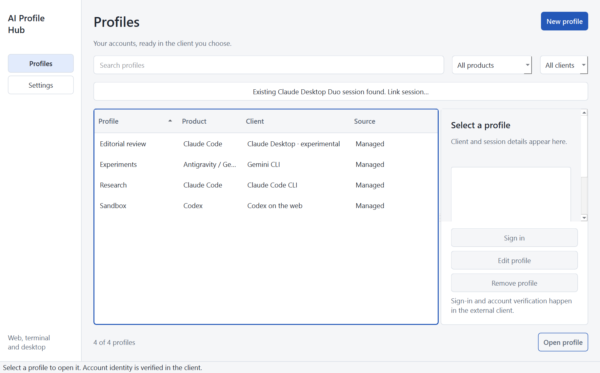
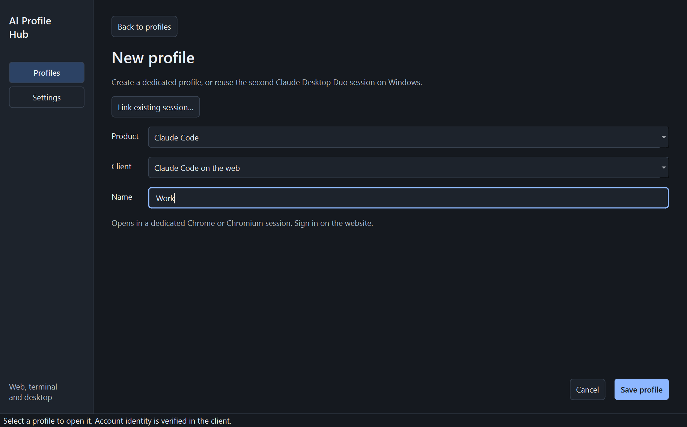
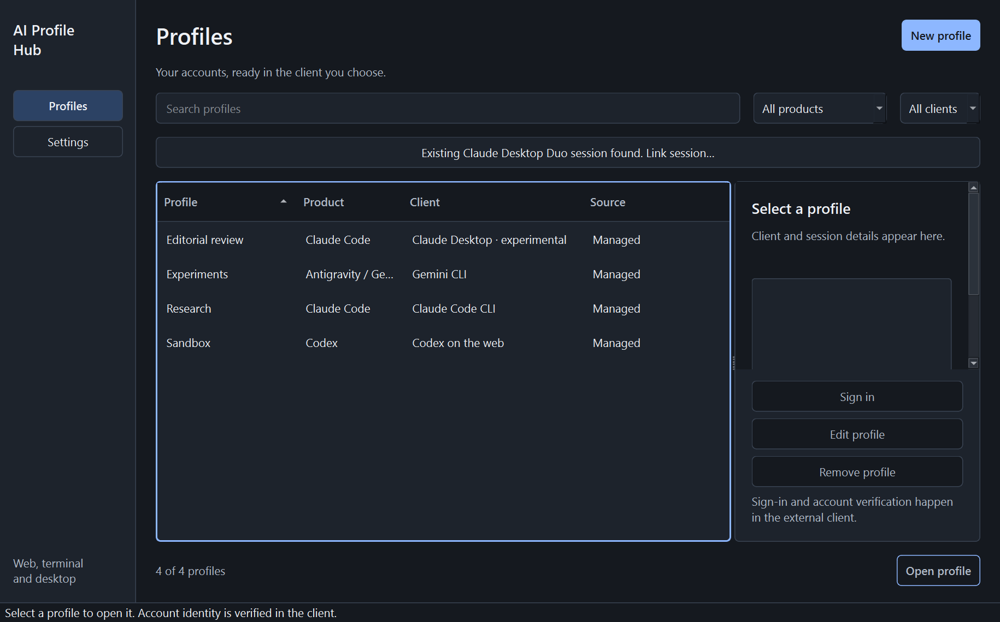

# AI Profile Hub

Desktop launcher for **Windows, macOS and Linux**, with a unified PySide6 / Qt Widgets interface. Find profiles for Claude Code, Codex and Antigravity / Gemini in one list, filter by product and client type, and open websites, terminal clients or desktop apps. Existing Claude Desktop Duo sessions on Windows appear alongside profiles managed by Hub.



## Quick start

Open a terminal in the repository root after downloading or cloning the source.

Source runs require Python 3.11 or later and the dependencies in `requirements.txt`. Create a virtual environment and install them first. The launch scripts use the repository's `.venv` automatically.

```powershell
py -3 -m venv .venv
.\.venv\Scripts\python -m pip install -r requirements.txt
```

On macOS and Linux:

```sh
python3 -m venv .venv
.venv/bin/python -m pip install -r requirements.txt
```

Standalone packages built below include Python and Qt. Keep the complete package folder together. Installed AI clients and Chrome or Chromium remain separate prerequisites. To open CLI profiles on Linux, you also need a graphical terminal such as GNOME Terminal, Konsole or xterm. On macOS, the first Terminal launch may require Automation permission.

On Windows, double-click `run.cmd` or run it from PowerShell.

```powershell
.\run.cmd
```

On macOS and Linux, run the shell launcher.

```sh
./run.sh
```

## Create and open profiles

1. Choose **New profile**, pick a product and client, and enter a name such as **Work**. Under **Advanced settings**, leave the executable blank for auto-detection or enter an absolute path. You can also set an existing working directory. Choose **Link existing session…** to reuse the second Claude Desktop Duo session on Windows; review its folder and choose **Link session** to confirm.
2. Select the saved profile and choose **Open profile** or press Enter. For web profiles, sign in in the dedicated Chrome or Chromium window. For terminal profiles, choose **Sign in** or sign in from the client. The Codex CLI sign-in button uses device code authentication, which must be enabled for your account or workspace. [Codex authentication](https://learn.chatgpt.com/docs/auth)
3. For desktop profiles, close other instances of the same client before choosing **Sign in**, then verify the account in the new window. To launch several profiles, hold Ctrl (Command on macOS) while selecting rows and choose **Open selected**.

## Manage profiles and browser settings

- Search by profile, product or client name; combine product and client filters. **Clear filters** returns to the complete list.
- Select a profile for its full name, source, session folder and client availability. In a compact window, choose **Details**. Client detection is cached for up to 30 seconds; **Refresh detection** checks again.
- Use **Edit profile** to change the name or paths. Create a new profile to use a different product or client. Invalid values stay in the form with an explanation so you can correct and save them.
- Close the associated windows or terminal before choosing **Remove profile**. The confirmation describes the local data removed. **Remove link** preserves the original Claude Desktop Duo folder. Your online account stays active.
- Use **Settings → Choose Chrome or Chromium…** to set a browser executable. **Use auto-detection** clears the override, including when the saved executable is unavailable.
- Choose **System**, **Light** or **Dark** appearance in Settings. Ctrl+N / Command+N creates a profile; Ctrl+F / Command+F focuses search; Enter in the list opens the selection.
- During an operation you can continue searching and navigating. Failed batch launches list each affected profile with guidance; **Retry failed** retries only those entries. A launch request does not prove sign-in or account isolation.

### Screenshots

**Create a profile**



**Dark appearance**



Screenshots captured from the Qt application on Windows on 2026-11-14 with synthetic data. Reproduce with `python tools/capture_ui.py`; captures and fixture databases default to ignored `dist/` folders. Earlier Tkinter captures are retained as historical assets.

## Reuse existing profiles

- **AI Profile Switch** uses the same local directory. On startup, AI Profile Hub updates the SQLite schema and reuses the existing profile IDs and folders. Existing Claude and ChatGPT web profiles still open their original websites. Create a separate profile for the new Claude Code and Codex destinations. To keep the option of returning to the earlier version, back up `profiles.sqlite3` before opening AI Profile Hub.
- **Claude Desktop Duo for Windows**. If `%LOCALAPPDATA%\ClaudeDesktopDuo\SecondProfile` exists, use the discovered-session prompt, **New profile → Link existing session…**, or **Settings → Link existing session…**. Review the original folder before confirming. The app reuses it without moving credentials. Repeating the action selects the existing link. Removing the link leaves the Duo data in its original folder. This integration covers the behavior already supported in Hub, rather than undocumented functions of the original Duo app.

## Available clients and limitations

| Product | Web | Locally installed clients |
| --- | --- | --- |
| Claude Code | Claude Code on the web, Claude on the web | Claude Code CLI (`claude`), Claude Desktop † |
| Codex | Codex on the web, ChatGPT on the web | Codex CLI (`codex`), Codex Desktop † |
| Antigravity / Gemini | Gemini on the web | Antigravity CLI (`agy`) †, Gemini CLI (`gemini`), Antigravity IDE †, Antigravity App † |

† Experimental. Availability varies by operating system and provider. Desktop apps can ignore the profile directory, reuse a running instance or route sign-in through the operating system. Verify the account in each client window. [Codex desktop and platforms](https://learn.chatgpt.com/docs/app) · [Community Codex desktop workaround](https://github.com/phoem/Codex-Profile-Launcher) · [Antigravity download](https://antigravity.google/download) · [Antigravity IDE forum](https://discuss.ai.google.dev/t/how-do-user-data-dir-and-profile-work/137054)

### Profile data

- The browser receives a separate `--user-data-dir` for each profile. [Chromium documentation](https://chromium.googlesource.com/chromium/src/+/HEAD/docs/user_data_dir.md)
- Claude Code receives `CLAUDE_CONFIG_DIR`. Anthropic documents this setting for signing in with different accounts. [Claude Code authentication](https://code.claude.com/docs/en/authentication)
- Codex receives `CODEX_HOME` and `CODEX_SQLITE_HOME`. The profile's `file` setting stores credentials in `auth.json`. Organization-managed authentication rules take precedence. [Codex configuration](https://learn.chatgpt.com/docs/config-file/config-advanced) · [Credential storage](https://learn.chatgpt.com/docs/auth)
- Gemini CLI receives `GEMINI_CLI_HOME` and uses the client's local credential storage. For `agy` and Antigravity, the launcher sets a dedicated process home and the relevant system directories. Google documents `~/.gemini/antigravity-cli/settings.json` and migration from Gemini CLI. Full `agy` authentication isolation still requires verification. [Gemini CLI](https://github.com/google-gemini/gemini-cli/blob/main/docs/cli/enterprise.md) · [Antigravity CLI settings](https://antigravity.google/docs/cli/using/) · [Google migration guide](https://antigravity.google/docs/cli/gcli-migration)
- On Windows, the launcher passes a dedicated profile folder to Claude Desktop. Update MSIX builds in the `2.42304.x` series, which can ignore this folder. Keeping one instance open for the first sign-in helps the browser return to the intended window. [MSIX issue](https://github.com/anthropics/claude-code/issues/103068)

Profile data is stored under `%LOCALAPPDATA%\AIProfileSwitch` on Windows, `~/Library/Application Support/AI Profile Switch` on macOS and `~/.local/share/ai-profile-switch` on Linux. On Linux, an absolute `XDG_DATA_HOME` overrides `~/.local/share`. The launcher leaves authentication files under the client's control. Clients run as the same operating system user and can access the same projects and system services.

## Build and test

The build checks Python syntax and uses `pyside6-deploy` / Nuitka to create a standalone folder (`.app` on macOS). The versioned configuration is `pysidedeploy.spec`. Install development dependencies in `.venv` first. Windows requires Visual Studio C++ Build Tools; macOS requires Xcode Command Line Tools; Linux requires a supported C compiler and the system libraries required by Qt. Compilation happens natively on each OS.

On Windows, with the Python launcher installed:

```powershell
.\.venv\Scripts\python -m pip install -r requirements-dev.txt
.\.venv\Scripts\python -m pytest -q
.\build.cmd
.\.venv\Scripts\python tools\smoke_package.py
```

On macOS and Linux:

```sh
.venv/bin/python -m pip install -r requirements-dev.txt
.venv/bin/python -m pytest -q
./build.sh
.venv/bin/python tools/smoke_package.py
```

Each build uses a fresh folder under `dist/native-builds/` and retains its intermediate files. `dist/latest-native.txt` records the executable path. `python build.py --dry-run` prints the deployment command. The previous dependency-free `.pyz` format is superseded by native packages; byte-for-byte reproducibility is not claimed for the new compiler toolchain. License texts and dependency notices accompany the package.

The GitHub Actions workflow defines tests on Python 3.11 and 3.13 across Windows, macOS and Linux, with native builds and package smoke tests on 3.13. Qt tests run offscreen in CI. `tools/smoke_package.py` verifies GUI startup and a bundled CLI session with an isolated synthetic client, without accessing real accounts. These checks do not substitute for native interactive client qualification; see [verification status](docs/verification.md).

To check account isolation with an installed client, use two test accounts, restart both profiles and verify the account in each client. Desktop support remains experimental. Signing, notarization, releases and automatic updates are not configured by this change.

## Get help

For launcher problems, include your operating system, Python version, client version and steps to reproduce. Share only redacted error text and synthetic profile data. [AI Profile Hub issues](https://github.com/dennidalpos/ai-profile-hub/issues)

Independent project. [MIT license](LICENSE).
