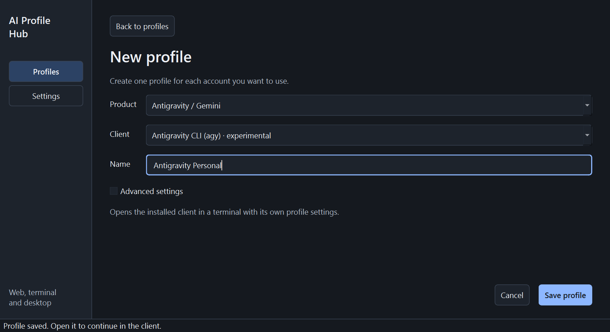
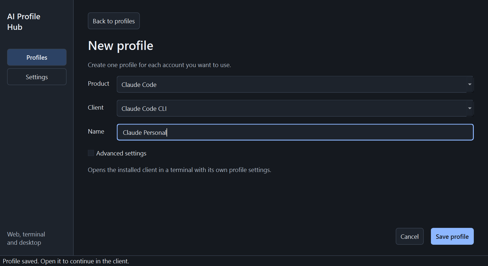

# Set up work and personal profiles

Create two profiles in AI Profile Hub for the same client, then sign in with the corresponding account in each. Start with the [README setup](../README.md#quick-start) and install the client you want to use. To match the screenshots, choose **Settings → Appearance → Dark**.

## Create the pair

1. Open **Profiles → New profile**. Choose the **Product** and **Client** shown for your provider below, then enter the example work name.
2. Leave **Advanced settings** closed to use automatic client detection and the default working directory. Open it if you need to choose an executable or a working directory.
3. Choose **Save profile**. Repeat with the same product and client and enter the personal name.

## Google Antigravity

Set **Product** to **Antigravity / Gemini** and **Client** to **Antigravity CLI (agy) · experimental**. Save **Antigravity Work** and **Antigravity Personal**. [Install Antigravity CLI](https://antigravity.google/docs/getting-started).

Open each profile with **Open profile**. If Antigravity prompts for Google sign-in, select the intended Google account. Antigravity CLI can silently reuse a session from your operating system's keyring. If both profiles open under the same identity, treat that setup as sharing an account. For two browser sessions with separate Google sign-ins, choose **Gemini on the web** for both profiles. [Google Antigravity authentication](https://antigravity.google/docs/install/#local-silent-keyring-sign-in) · [Hub's Google client verification](google-authentication.md).

For **Antigravity App** or **Antigravity IDE**, choose the corresponding client for both profiles. Quit the other instances before starting sign-in from Hub. Check the Google account in each client after reopening it. [Google Antigravity downloads](https://antigravity.google/download).

## OpenAI Codex

Set **Product** to **Codex** and **Client** to **Codex CLI**. Save **Codex Work** and **Codex Personal**. [Codex CLI](https://help.openai.com/en/articles/11369540-using-codex-with-your-chatgpt-plan).

Select one profile and choose **Sign in**. Complete device-code sign-in in the browser with the intended ChatGPT account or workspace, then repeat for the other profile. If device-code sign-in is unavailable, choose **Open profile** and use the interactive sign-in flow if your workspace allows it. [Codex authentication](https://learn.chatgpt.com/docs/auth).

## Anthropic Claude Code

Set **Product** to **Claude Code** and **Client** to **Claude Code CLI**. Save **Claude Work** and **Claude Personal**. [Claude Code setup](https://code.claude.com/docs/en/setup).

Select the work profile, choose **Sign in**, and complete the Claude Code sign-in flow for your work account. Repeat for the personal profile with your personal account. In each Claude Code session, use `/status` to check the account. [Claude Code authentication](https://code.claude.com/docs/en/authentication) · [Claude Code commands](https://support.claude.com/en/articles/14553413-claude-code-cheatsheet).

## Check both accounts

Close each client session, reopen each profile individually from Hub, and confirm the account or workspace in the client. The names in Hub label the saved profiles. You verify the account in the external client.

For a browser-based pair, choose **Codex on the web** or **Claude Code on the web** for both profiles, then open each and sign in in its own Chrome or Chromium window. For an experimental desktop pair, choose **ChatGPT desktop app** or **Claude Desktop** for both profiles and complete sign-in with one instance open at a time. [ChatGPT desktop app](https://learn.chatgpt.com/docs/app) · [Claude Desktop](https://support.claude.com/en/articles/10065433-install-claude-desktop).

The [six-profile overview in the README](../README.md#ai-profile-hub) and the screenshots above were captured from the Windows Qt app with synthetic profiles. [Reproduce the captures](verification.md#reproduce).
