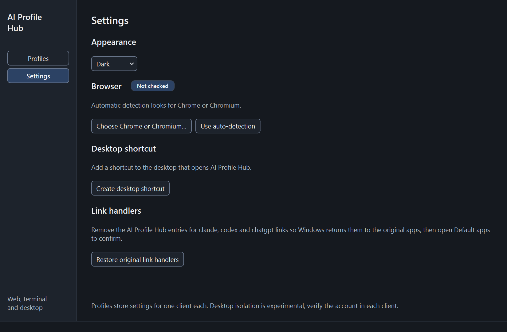
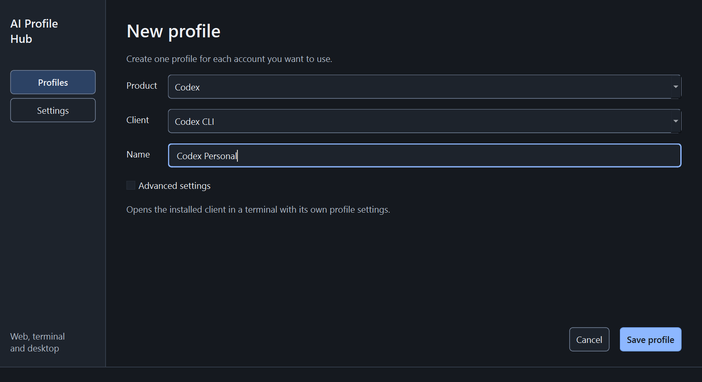

# Set up work and personal profiles

Create two profiles in AI Profile Hub for the same client, one for each account. Start with the [README setup](../README.md#quick-start). Install Chrome or Chromium for web profiles, or install the terminal or desktop client you choose.

## Create the pair

1. Open **Profiles → New profile**. Choose the **Product** and **Client** shown for your provider below, then enter the example work name.
2. For a terminal or desktop client, leave **Advanced settings** untouched to use automatic detection and your home directory. To use a different executable or working directory, enter its absolute path.
3. Choose **Save profile**. Repeat with the same product and client and enter the personal name.

## Browser profiles

1. Choose the same web client for both profiles, such as **Codex on the web**, **Claude Code on the web** or **Gemini on the web**. Give each a distinct work or personal name.
2. If Hub finds the wrong browser or cannot find one, use **Settings → Choose Chrome or Chromium…** to select the executable. **Use auto-detection** clears that choice and checks immediately. See the status next to **Browser** and hover over the executable name to see its full path.
3. Select one profile, choose **Open profile** and sign in with the intended account. Repeat for the second profile. Hub opens each web profile with its own browser data directory.

## OpenAI Codex

Set **Product** to **Codex** and **Client** to **Codex CLI**. Save **Codex Work** and **Codex Personal**. [Codex CLI](https://help.openai.com/en/articles/11369540-using-codex-with-your-chatgpt-plan).

Select one profile and choose **Sign in** in the profile details. This uses device-code sign-in, which must be enabled in your personal ChatGPT security settings or by your workspace admin. Complete sign-in, then repeat for the other profile. If device-code sign-in is unavailable, choose **Open profile** and follow the interactive sign-in flow if your workspace allows it. [Codex authentication](https://learn.chatgpt.com/docs/auth#preferred-device-code-authentication-beta).

## Anthropic Claude Code

Set **Product** to **Claude Code** and **Client** to **Claude Code CLI**. Save **Claude Work** and **Claude Personal**. [Claude Code setup](https://code.claude.com/docs/en/setup).

Select the work profile, choose **Sign in** in the profile details and complete the Claude Code sign-in flow for your work account. Repeat for the personal profile with your personal account. In each Claude Code session, use `/status` to check the account. [Claude Code authentication](https://code.claude.com/docs/en/authentication) · [Claude Code commands](https://support.claude.com/en/articles/14553413-claude-code-cheatsheet).

## Google Antigravity / Gemini

For **Gemini CLI**, select **Antigravity / Gemini** as the product and **Gemini CLI** as the client. Save **Gemini Work** and **Gemini Personal**. Open each profile and follow Gemini CLI's sign-in prompts. Check which account the client uses after restarting each profile. [Google authentication audit](google-authentication.md).

For **Antigravity CLI (agy) · experimental**, save **Antigravity Work** and **Antigravity Personal** and choose **Open profile** for each. If Antigravity prompts for Google sign-in, select the intended account. Antigravity can silently reuse a session from the operating system's keyring. If both profiles open under the same identity, use two **Gemini on the web** profiles for separate browser sign-ins. [Install Antigravity CLI](https://antigravity.google/docs/getting-started) · [Google Antigravity authentication](https://antigravity.google/docs/install/#local-silent-keyring-sign-in).

## Experimental desktop profiles

Choose the same desktop client for both profiles. Hub offers **Claude Desktop**, **ChatGPT desktop app**, **Antigravity IDE** and **Antigravity App**. Quit other instances of that client, select one profile and choose **Sign in**. Complete sign-in in the client window. Quit the client before repeating the process for the second profile. [Desktop client limitations](../README.md#available-clients-and-limitations).

For ChatGPT and Antigravity, start with **New profile** even if you already use the desktop app. If Hub cannot find the installed client, set its executable under **Advanced settings**. On Windows, Hub can [link a compatible Claude Desktop session](../README.md#reuse-existing-profiles).

## Check both accounts

Close both sessions. Reopen the work profile by itself and confirm the account or workspace in the client. Close it, reopen the personal profile and check that identity too. A profile name is the label you entered. The client window or terminal shows the account in use.

The [six-profile overview in the README](../README.md#ai-profile-hub) and the screenshots above were captured from the Windows Qt app with synthetic profiles in **Dark** appearance. [Reproduce the captures](verification.md#reproduce).
